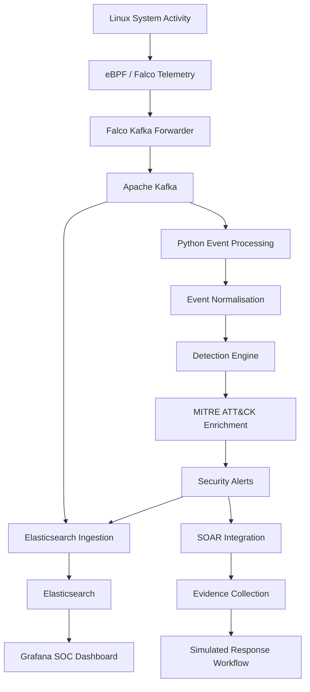

# eBPF-Powered Autonomous Threat Hunting SOC

**An integrated Linux security monitoring and threat detection framework powered by eBPF-based telemetry, Apache Kafka, MITRE ATT&CK, Elasticsearch, Grafana, and SOAR workflows.**

This is developed as part of the Cybersecurity Internship at **Zaalima Development Pvt. Ltd.**

[](https://www.python.org/)
[](https://ubuntu.com/)
[](https://kafka.apache.org/)
[](https://www.elastic.co/elasticsearch)
[](https://grafana.com/)
[](https://attack.mitre.org/)

---

## 1. Project Overview

Modern Linux environments are continuously generate system-level events involving process execution, file operations, and network activities. Identifying suspicious behaviour within this large volume of telemetry can be challenging without an integrated security monitoring solution.

The **eBPF-Powered Autonomous Threat Hunting SOC** project addresses this challenge by developing a modular Security Operations Centre (SOC) framework that collects system telemetry, processes security events, detects suspicious activities, enriches detections with MITRE ATT&CK context, and provides centralised security monitoring.

The framework combines eBPF-based runtime monitoring with event streaming, Python-based detection modules, Elasticsearch storage, Grafana visualisation, and incident-response workflows.

### Project Objectives

- Monitor Linux system activities, including process execution and file operations.
- Collect runtime security telemetry using eBPF-based monitoring through Falco.
- Stream security events using Apache Kafka.
- Normalise raw telemetry into structured security events.
- Identify suspicious behaviour using rule-based detection and supported behavioural analysis.
- Enrich applicable detections using the MITRE ATT&CK framework.
- Centralise security events and alerts using Elasticsearch.
- Visualise security activity through Grafana dashboards.
- Integrate alert routing, evidence collection, and incident-response workflows.
- Provide a modular foundation for future autonomous threat hunting and response capabilities.

---

## 2. System Architecture

The system follows a modular event-processing architecture in which telemetry is collected, streamed, analysed, stored, and visualised.

### Architecture Diagram



### Architecture Components

| Component | Responsibility |
|---|---|
| Linux System | Source of system-level activities |
| eBPF / Falco | Runtime telemetry collection |
| Kafka Forwarder | Sends Falco events to Kafka |
| Apache Kafka | Event streaming and distribution |
| Event Processing | Converts raw events into structured records |
| Detection Engine | Evaluates events against detection rules |
| MITRE ATT&CK | Provides threat classification and context |
| Elasticsearch | Stores and indexes security events and alerts |
| SOAR Integration | Supports alert routing and response workflows |
| Grafana | Displays security events and monitoring metrics |

The architecture is modular, allowing individual components to be developed, tested, and integrated independently.

---

## 3. Technology Stack

| Technology | Purpose |
|---|---|
| Python | Event processing, detection, and automation |
| eBPF | Efficient system-level telemetry |
| Falco | Runtime security monitoring |
| Apache Kafka | Real-time event streaming |
| MITRE ATT&CK | Threat classification and enrichment |
| Elasticsearch | Security event indexing and storage |
| Grafana | SOC dashboard and visualisation |
| n8n Webhook Integration | Alert routing and workflow integration |
| SQLite / JSON | Supporting structured data and event storage where applicable |
| pytest | Automated testing |
| Docker | Containerised infrastructure |
| Ubuntu / WSL2 | Development and execution environment |
| Git / GitHub | Version control and collaboration |

---

## 4. Core Modules

### 4.1 Telemetry Collection

The telemetry layer monitors Linux system activities using Falco with modern eBPF-based monitoring.

It collects runtime events associated with system behaviour, including process execution and file activity.

A custom Falco rule is also configured to demonstrate file-write event generation.

### 4.2 Event Streaming

Apache Kafka acts as the event-streaming layer.

The Falco Kafka forwarder reads generated Falco events and publishes them to the `security-events` Kafka topic.

This separates telemetry collection from downstream processing and enables independent consumers.

### 4.3 Event Normalisation and Processing

Raw telemetry is converted into structured security-event records.

The processing layer helps maintain a consistent event format, making the data suitable for detection, enrichment, storage, and investigation.

### 4.4 Detection Engine

The Python-based detection engine evaluates incoming security events against configured detection rules.

Its responsibilities include:

- Identifying suspicious system activities.
- Evaluating event characteristics.
- Generating structured security alerts.
- Supporting event correlation and behavioural analysis through the project's detection modules.

### 4.5 MITRE ATT&CK Integration

The project incorporates MITRE ATT&CK mapping to associate supported detections with known adversary tactics and techniques.

This provides additional context for security analysts and helps organise findings according to recognised attack behaviours.

MITRE enrichment is applied where a detection has a supported mapping; not every event necessarily corresponds to an ATT&CK technique.

### 4.6 Threat Hunting

The threat-hunting components support the investigation of suspicious activity and the identification of potentially malicious behaviour.

They provide an additional analytical layer beyond basic event collection and monitoring.

### 4.7 Elasticsearch Integration

Elasticsearch provides centralised storage and indexing for processed security events and generated alerts.

The Kafka-to-Elasticsearch ingestion component consumes events, applies the configured processing and detection logic, and indexes the resulting records.

### 4.8 SOC Dashboard

Grafana provides a centralised interface for monitoring security activity.

The implemented dashboard includes four main panels:

1. **Total Security Events** – Displays the overall number of indexed security events.
2. **Security Events by Severity** – Provides a breakdown of event severity.
3. **Security Events Detail Table** – Displays individual event records.
4. **Security Events Trend** – Visualises security events over time.

### 4.9 SOAR Integration

The SOAR layer provides integration between security detections and incident-response workflows.

Implemented capabilities include:

- Detection alert integration.
- Webhook-based alert routing.
- Evidence collection.
- Incident-response planning.
- Simulated containment workflows.

The current implementation demonstrates response planning in a controlled manner. Actual process termination, host isolation, and firewall blocking are not enabled.

---

## 5. End-to-End Event Processing

The primary event-processing workflow is:

1. Linux system activity generates runtime telemetry.
2. Falco identifies configured system events.
3. The Falco forwarder publishes event data to Apache Kafka.
4. Python consumers process the incoming events.
5. The detection engine evaluates applicable events.
6. Supported detections receive MITRE ATT&CK enrichment.
7. Security events and generated alerts are indexed in Elasticsearch.
8. Grafana retrieves and visualises indexed security data.
9. The SOAR integration supports evidence collection and simulated incident-response planning.

This workflow demonstrates how individual security components work together to provide centralised monitoring and threat investigation capabilities.

---

## 6. Sample Security Event

The following is an illustrative example of a structured security event. Actual fields and values depend on the event source and normalisation process.

```json
{
  "event_id": "SOC-EVENT-001",
  "event_type": "file_activity",
  "source": "falco",
  "host": "linux-test-machine",
  "severity": "low",
  "rule_name": "SOC Test File Write",
  "message": "A monitored file-write activity was detected",
  "mitre_tactics": [],
  "mitre_techniques": []
}
```

Events are processed and stored in structured formats to support searching, analysis, and downstream integrations.

---

## 7. Repository Structure

```text
eBPF-Autonomous-Threat-Hunting-SOC/
│
├── detection/
│   ├── event_schema.py
│   ├── event_normalizer.py
│   ├── detection_engine.py
│   └── mitre/
│       └── attack_mapping.py
│
├── telemetry/
│   ├── falco/
│   │   └── falco_kafka_forwarder.py
│   ├── kafka/
│   │   └── docker-compose.yml
│   └── kafka_detection_consumer.py
│
├── dashboard/
│   ├── ingestion/
│   │   ├── docker-compose.yml
│   │   └── kafka_to_elasticsearch.py
│   ├── grafana/
│   │   ├── docker-compose.yml
│   │   └── soc_dashboard.json
│   ├── docs/
│   └── README.md
│
├── soar/
│   ├── detection_integration.py
│   ├── n8n_webhook.py
│   └── response/
│       ├── week3_workflow.py
│       └── week3_demo_output.txt
│
├── tests/
│
├── scripts/
│
└── README.md
```

The repository also contains supporting detection, threat-hunting, configuration, documentation, and testing modules.

---

## 8. Installation and Setup

### Prerequisites

- Python 3
- Ubuntu Linux or Ubuntu on WSL2
- Docker Desktop with WSL integration, or Docker Engine
- Apache Kafka
- Falco with modern eBPF support
- Git
- Required Python dependencies

### Step 1: Clone the Repository

```bash
git clone https://github.com/gnapiika/eBPF-Autonomous-Threat-Hunting-SOC.git

cd eBPF-Autonomous-Threat-Hunting-SOC
```

### Step 2: Create a Virtual Environment

```bash
python3 -m venv .venv-wsl

source .venv-wsl/bin/activate
```

Install the required dependencies using the dependency file provided in the repository, if available.

### Step 3: Start Apache Kafka

```bash
docker compose -f telemetry/kafka/docker-compose.yml up -d
```

Verify the Kafka container:

```bash
docker ps
```

### Step 4: Start Elasticsearch

```bash
docker compose -f dashboard/ingestion/docker-compose.yml up -d
```

Verify Elasticsearch:

```bash
curl http://localhost:9200
```

### Step 5: Start Grafana

```bash
docker compose -f dashboard/grafana/docker-compose.yml up -d
```

Open the Grafana interface:

```text
http://localhost:3000
```

Configure the Elasticsearch data source if it has not already been provisioned.

### Step 6: Verify Falco

```bash
sudo systemctl status falco-modern-bpf
```

Falco must be installed and running before starting the telemetry forwarder.

### Step 7: Start the Falco Kafka Forwarder

Open a separate terminal:

```bash
cd eBPF-Autonomous-Threat-Hunting-SOC

source .venv-wsl/bin/activate

PYTHONPATH="$PWD" python telemetry/falco/falco_kafka_forwarder.py
```

### Step 8: Start the Detection Consumer

Open another terminal:

```bash
cd eBPF-Autonomous-Threat-Hunting-SOC

source .venv-wsl/bin/activate

PYTHONPATH="$PWD" python telemetry/kafka_detection_consumer.py
```

### Step 9: Start Elasticsearch Ingestion

Open another terminal:

```bash
cd eBPF-Autonomous-Threat-Hunting-SOC

source .venv-wsl/bin/activate

PYTHONPATH="$PWD" \
ELASTICSEARCH_URL=http://localhost:9200 \
KAFKA_BOOTSTRAP_SERVERS=localhost:9092 \
python -u dashboard/ingestion/kafka_to_elasticsearch.py
```

Keep the pipeline processes running while generating and monitoring test events.

**Note:** These commands assume the default local service addresses used in the development environment. Update environment variables when deploying the components on different hosts.

---

## 9. Testing and Validation

Automated tests are used to validate the project's detection, MITRE ATT&CK, event-processing, and SOAR integration components.

Run the complete test suite from the repository root:

```bash
PYTHONPATH="$PWD" python -m pytest -q
```

### Latest Recorded Test Results

| Metric | Result |
|---|---:|
| Total tests passed | 57 |
| Failed tests | 0 |
| Test status | Passed |

The project has also undergone integration validation involving:

- Falco telemetry generation.
- Kafka event forwarding.
- Python event processing.
- Elasticsearch event ingestion.
- Grafana dashboard visualisation.
- SOAR integration and simulated response workflows.

A controlled file-write event has been generated and observed in the Elasticsearch security-events index and Grafana dashboard.

**Testing note:** The 57 passing tests represent the latest recorded automated test run. Integration verification was performed separately using the running services and controlled demonstration events.

---

## 10. Team Responsibilities

The project was developed collaboratively by a four-member cybersecurity internship team.

| Member | Responsibilities |
|---|---|
| Member 1 | eBPF telemetry collection and Kafka streaming |
| Member 2 | Detection engine, MITRE ATT&CK integration, and threat hunting |
| Member 3 | SOAR integration and incident-response workflows |
| Member 4 | Elasticsearch integration and Grafana dashboard development |

The components were integrated through shared event formats and modular interfaces.

---

## 11. Future Enhancements

Although the current implementation demonstrates an integrated SOC monitoring workflow, several enhancements can further improve its capabilities.

- Expand telemetry coverage using additional eBPF-based monitoring tools.
- Integrate and validate additional attack scenarios.
- Improve behavioural anomaly detection and process-chain correlation.
- Expand MITRE ATT&CK coverage.
- Implement approval-controlled real incident containment.
- Extend SOAR automation with additional response integrations.
- Improve forensic evidence collection and investigation capabilities.
- Introduce role-based access control and stronger deployment security.
- Improve scalability, fault tolerance, and production deployment.
- Extend dashboard analytics and alert prioritisation.

---

## 12. Project Status

The project has reached an integrated prototype stage.

| Area | Implementation Status |
|---|---|
| Falco/eBPF telemetry | Implemented and validated |
| Kafka event streaming | Implemented and validated |
| Event processing | Implemented and tested |
| Detection engine | Implemented and tested |
| MITRE ATT&CK enrichment | Implemented and tested |
| Elasticsearch ingestion | Implemented and validated |
| Grafana dashboard | Implemented and validated |
| SOAR integration | Implemented; response simulation |
| Automated testing | 57 tests passed |

The project demonstrates an end-to-end security monitoring pipeline while providing a foundation for further development towards autonomous threat detection and incident response.

---

## 13. Contributors

Developed collaboratively as part of the Cybersecurity Internship at **Zaalima Development Pvt. Ltd.**

**GitHub Repository:**  
https://github.com/gnapiika/eBPF-Autonomous-Threat-Hunting-SOC

**Project:** eBPF-Powered Autonomous Threat Hunting SOC

**Domain:** Cybersecurity | Security Operations | Threat Hunting | eBPF | SIEM | SOAR

---

*This project is an academic and internship prototype developed for cybersecurity monitoring, threat detection, and incident-response research. It is not intended to be deployed as a production security platform without additional security hardening, testing, and operational controls.*
